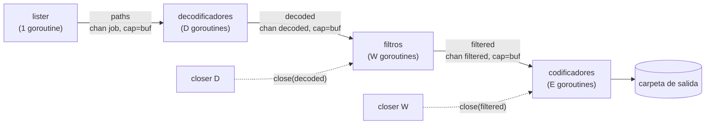

# PixelFlow · pipeline concurrente de imágenes en Go

PixelFlow procesa carpetas con cientos de imágenes JPEG/PNG aplicando una cadena
de filtros (escala de grises, desenfoque, redimensionado y, como extensión,
Sobel) mediante un pipeline concurrente **listar → decodificar → filtrar →
codificar** con fan-out/fan-in, canales acotados, cancelación con `context` y
coordinación de errores con `errgroup`.

Proyecto P4 del proyecto integrador de Programación Concurrente.
Integrantes: Francisco Rafael Corzo Pérez · Leonardo de Jesús Martínez Martínez.

## Requisitos

- Go 1.22 o superior (probado con Go 1.24.7, Linux x86-64).
- Única dependencia: `golang.org/x/sync/errgroup`, incluida en `vendor/`, por
  lo que **compila y se prueba sin Internet**.

## Inicio rápido (< 5 minutos)

```bash
# 1. Compilar
go build -o bin/pixelflow ./cmd/pixelflow
go build -o bin/genimages ./cmd/genimages

# 2. Generar 120 imágenes sintéticas 800×600 (mitad PNG, mitad JPEG)
./bin/genimages -out data/in -n 120 -w 800 -h 600

# 3. Procesar con 4 goroutines por etapa
./bin/pixelflow -in data/in -out data/out -filtros gray,blur:2,resize:50% -workers 4

# 4. Pruebas (incluye detector de carreras, 3 repeticiones)
go vet ./... && gofmt -l . | grep -v ^vendor/   # no debe listar nada
go test -race -count=3 ./...
go test -cover ./...
```

## Interfaz web

```bash
go run ./cmd/pixelflow-web          # abrir http://localhost:8080
```

Permite elegir filtros, goroutines por etapa, búfer y franjas; ver el progreso
en vivo, comparar cada imagen antes/después con un deslizador, ver el tiempo
por etapa y un historial con el speedup frente a la ejecución secuencial.
Solo usa `net/http` y `embed`; Ctrl+C cancela la ejecución en curso y apaga el
servidor de forma ordenada.

Con `make`: `make build`, `make race`, `make cover`, `make demo`, `make bench`.

## Uso

```
pixelflow [flags]
  -in DIR          carpeta de entrada (default data/in)
  -out DIR         carpeta de salida (default data/out)
  -filtros SPEC    gray | blur[:r] | resize:WxH | resize:P% | sobel, separados por comas
  -workers N       goroutines de filtrado (default GOMAXPROCS)
  -decoders N      goroutines de decodificación (0 = igual que -workers)
  -encoders N      goroutines de codificación (0 = igual que -workers)
  -buf N           capacidad de cada canal intermedio (default 4)
  -franjas N       franjas paralelas dentro de cada imagen (extensión)
  -calidad N       calidad JPEG de salida (default 90)
  -timeout D       plazo máximo, p. ej. 30s (0 = sin plazo)
  -secuencial      usar la versión secuencial de referencia
  -cpuprofile F    escribir perfil de CPU (pprof)
  -q               no imprimir cada archivo
```

Códigos de salida: `0` éxito · `1` error de procesamiento · `2` flags inválidas ·
`124` plazo agotado · `130` interrumpido con Ctrl+C.

### Demostraciones para la defensa

```bash
# Ctrl+C a mitad del procesamiento: resumen parcial, sin temporales ni goroutines colgadas
./bin/genimages -out data/big -n 300
./bin/pixelflow -in data/big -out data/bigout -q      # pulsar Ctrl+C

# El primer error cancela todo (errgroup)
./bin/genimages -out data/bad -n 40 -corrupta 5
./bin/pixelflow -in data/bad -out data/badout -q     # → error: decodificar img_0005.jpg ...

# Carrera de datos introducida a propósito y detectada por -race
go test -race -tags racedemo -run RaceDemo ./internal/pipeline

# Perfil de CPU
./bin/pixelflow -in data/in -out data/out -q -cpuprofile cpu.prof
go tool pprof -top bin/pixelflow cpu.prof
```

## Arquitectura



| Canal | Escribe | Lee | Cierra |
|---|---|---|---|
| `paths` (cap `buf`) | lister | D decodificadores | lister (`defer close`) |
| `decoded` (cap `buf`) | D decodificadores | W filtros | closer de la etapa D, tras `wg.Wait()` |
| `filtered` (cap `buf`) | W filtros | E codificadores | closer de la etapa W, tras `wg.Wait()` |

Todas las goroutines se crean con `errgroup.WithContext`; todo envío/recepción
bloqueante está en un `select` con `ctx.Done()`. Detalle completo en
[`docs/ARQUITECTURA.md`](docs/ARQUITECTURA.md).

## Estructura

```
cmd/pixelflow     CLI: flags, señales (Ctrl+C), pprof, resumen
cmd/pixelflow-web interfaz web local (net/http + embed)
cmd/genimages     generador de imágenes sintéticas deterministas
internal/filters  filtros puros + paralelismo por franjas (extensión)
internal/pipeline Run (concurrente) y RunSequential (referencia)
internal/imgio    listar / decodificar / codificar (escritura atómica)
internal/synth    imágenes sintéticas para pruebas y benchmarks
scripts/bench.sh  reproduce todos los experimentos → results/
results/          datos crudos de los experimentos del informe
```

## Experimentos

```bash
./scripts/bench.sh 5        # 5 repeticiones; ~6 min en 2 vCPU
# o solo los benchmarks de go test con GOMAXPROCS = 1, 2, 4, 8:
go test ./internal/pipeline -run '^$' -bench Pipeline -cpu 1,2,4,8 -count 5 -benchmem
```
